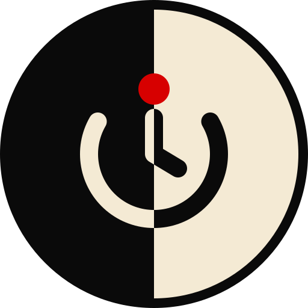
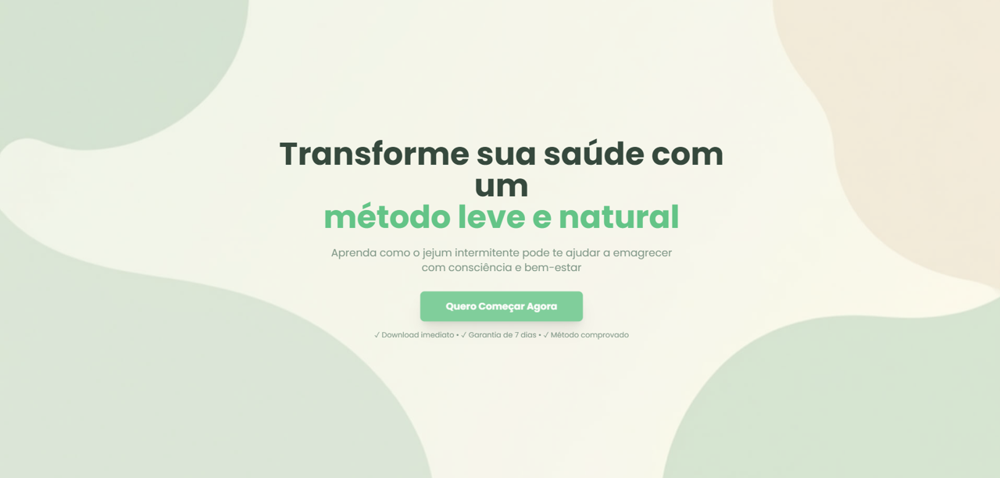
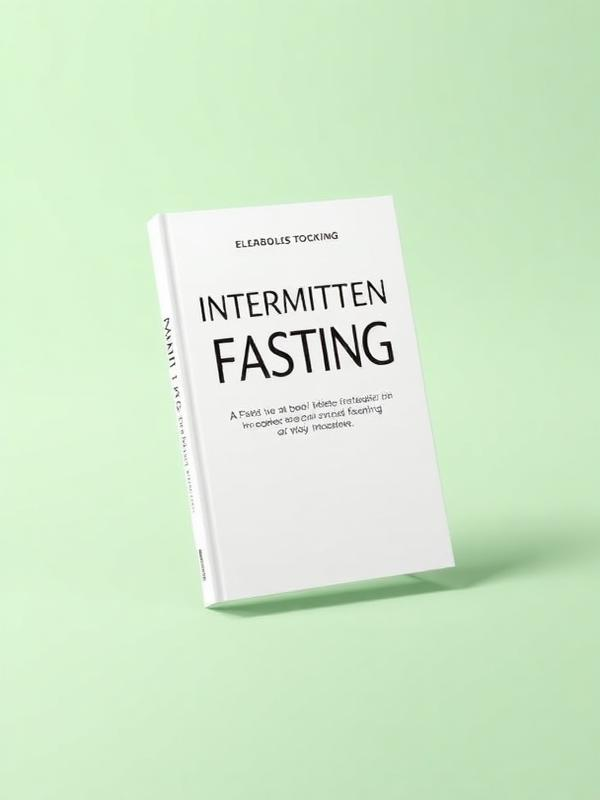
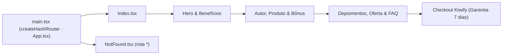

<a id="top"></a>

<div align="center">

<picture>
  <source media="(prefers-color-scheme: dark)" srcset="https://raw.githubusercontent.com/voaneves/jejumintermitente/main/assets/logo/logo-dark.svg" />
  <source media="(prefers-color-scheme: light)" srcset="https://raw.githubusercontent.com/voaneves/jejumintermitente/main/assets/logo/logo-light.svg" />
  
</picture>

<h1>Jejum Intermitente: Landing Page</h1>

<p>
  <strong>Página de vendas de alta conversão para o e-book "Guia Prático do Jejum Intermitente", em React, Vite, TypeScript e Tailwind CSS.</strong><br />
  <sub>
    Jornada linear em 9 seções com SEO estruturado, shadcn/ui e deploy contínuo —
    <kbd>React</kbd> · <kbd>Vite</kbd> · <kbd>TypeScript</kbd> · <kbd>Tailwind CSS</kbd> · <kbd>shadcn/ui</kbd>
  </sub>
</p>

<p>
  <a href="https://voaneves.github.io/jejumintermitente/"><picture><source media="(prefers-color-scheme: dark)" srcset="https://raw.githubusercontent.com/voaneves/jejumintermitente/main/assets/buttons/live-dark.svg" /></picture></a>
  <a href="#como-rodar"><picture><source media="(prefers-color-scheme: dark)" srcset="https://raw.githubusercontent.com/voaneves/jejumintermitente/main/assets/buttons/run-dark.svg" /></picture></a>
</p>

<p><sub>Precisa de uma landing page assim? <a href="https://voaneves.com/#contato"><strong>Vamos conversar →</strong></a></sub></p>

<p>
  <a href="https://github.com/voaneves/jejumintermitente/actions/workflows/deploy.yml"></a>
  <a href="https://github.com/voaneves/jejumintermitente/blob/main/LICENSE"></a>
  
</p>

<p>
  <a href="https://voaneves.github.io/jejumintermitente/">Página</a> ·
  <a href="#funcionalidades">Funcionalidades</a> ·
  <a href="#arquitetura">Arquitetura</a> ·
  <a href="#tokens">Tokens &amp; Estrutura</a> ·
  <a href="#como-rodar">Como rodar</a> ·
  <a href="#contato">Contato</a>
</p>

</div>

<picture>
  <source media="(prefers-color-scheme: dark)" srcset="https://raw.githubusercontent.com/voaneves/jejumintermitente/main/assets/brand/rule-dark.svg" />
  <source media="(prefers-color-scheme: light)" srcset="https://raw.githubusercontent.com/voaneves/jejumintermitente/main/assets/brand/rule-light.svg" />
  
</picture>

<a id="funcionalidades"></a>
## Sobre o projeto

Apresente benefícios, prova social, bônus e garantia do e-book **"Guia Prático do Jejum Intermitente"** em um funil objetivo pensado para carregamento rápido no celular.

Página ao vivo: <https://voaneves.github.io/jejumintermitente/>

<table>
  <tr>
    <td width="65%" valign="top" align="center">
      <a href="https://voaneves.github.io/jejumintermitente/">
        
      </a>
      <br />
      <sub><strong>Landing Page</strong> — abertura com proposta clara e CTA direto</sub>
    </td>
    <td width="35%" valign="top" align="center">
      
      <br />
      <sub><strong>Mockup do E-book</strong> — exibido em <code>ProductSection</code></sub>
    </td>
  </tr>
</table>

### Funil em 9 blocos e oferta estruturada

`src/pages/Index.tsx` compõe linearmente `HeroSection`, `BenefitsSection`, `AuthorSection`, `ProductSection`, `BonusSection` (*Checklist de 7 Dias* e *Mini Cardápio Prático*), `TestimonialsSection`, `OfferSection`, `FAQSection` e `Footer`, com selo de garantia de 7 dias integrado ao checkout Kiwify.

### SEO, Schema.org e entrega estática

`index.html` embarca Open Graph (`pt_BR`), Twitter Card, tags canônicas e dados estruturados JSON-LD (`WebPage` + `Product` / `EBook`)[^1] sobre tipografia Poppins (Google Fonts) e ícones `lucide-react`.

<a id="arquitetura"></a>
## Arquitetura de seções e roteamento



<a id="tokens"></a>
## Design tokens e estrutura de pastas

Tokens semânticos em [`src/index.css`](./src/index.css) combinam creme suave e verde-menta (`#6ee7b7` → `#34d399` no logotipo [`src/assets/img/logo.svg`](./src/assets/img/logo.svg)):

| Token / Elemento | Valor em `src/index.css` | Uso principal |
| :--- | :--- | :--- |
| `--background` | `45 30% 97%` | Fundo quente de leitura |
| `--foreground` | `140 15% 25%` | Texto principal de alto contraste |
| `--primary` | `142 45% 58%` | Botões principais de conversão |
| `--wellness` / `--soft-beige` | `142 35% 85%` / `45 25% 95%` | Faixas de bônus e explicação |

<dl>
  <dt><strong>Casca e provedores (<code>src/App.tsx</code>)</strong></dt>
  <dd>Envolve <code>QueryClientProvider</code>, <code>TooltipProvider</code>, <code>Toaster</code>/<code>Sonner</code> e roteamento <code>createHashRouter</code> para compatibilidade com subdiretórios no GitHub Pages.</dd>
  <dt><strong>Componentes UI (<code>src/components/ui/</code>)</strong></dt>
  <dd>Primitivos **shadcn/ui** versionados direto no projeto junto às seções em <code>src/components/</code>.</dd>
</dl>

<a id="como-rodar"></a>
## Como rodar e deploy

Requer **Node.js** LTS (`18+` no CI) e **npm**:

```bash
git clone https://github.com/voaneves/jejumintermitente.git
cd jejumintermitente
npm install
npm run dev      # http://localhost:8080 (vite.config.ts)
npm run build    # gera ./dist com base: '/jejumintermitente/'
npm run lint     # verificação ESLint
```

> [!TIP]
> O workflow [`.github/workflows/deploy.yml`](./.github/workflows/deploy.yml) compila `./dist` a cada push na branch `main` e publica automaticamente no GitHub Pages via `actions/deploy-pages@v4`.

**Agradecimentos:** [Vite](https://vitejs.dev/), [React](https://react.dev/), [Tailwind CSS](https://tailwindcss.com/), [Shadcn/UI](https://ui.shadcn.com/) e [GitHub Pages](https://pages.github.com/).

<a id="contato"></a>
## Contato

<p>
  <a href="https://voaneves.com/#contato"><picture><source media="(prefers-color-scheme: dark)" srcset="https://raw.githubusercontent.com/voaneves/jejumintermitente/main/assets/buttons/hire-dark.svg" /></picture></a>
  <a href="https://voaneves.com/"><picture><source media="(prefers-color-scheme: dark)" srcset="https://raw.githubusercontent.com/voaneves/jejumintermitente/main/assets/buttons/site-dark.svg" /></picture></a>
</p>

<a href="https://linkedin.com/in/voaneves">LinkedIn</a> · <a href="mailto:victorneves478@gmail.com">E-mail</a>

<p align="center">
  
</p>

<p align="center"><sub>Distribuído sob a <a href="https://github.com/voaneves/jejumintermitente/blob/main/LICENSE">licença MIT</a> © 2026 <a href="https://github.com/voaneves">Victor Neves</a> · <strong>VOANEVES.</strong></sub></p>

<p align="center"><sub><a href="#top">↑ Voltar ao topo</a></sub></p>

[^1]: Metadados estruturados JSON-LD e tags Open Graph configurados em [`index.html`](./index.html).
